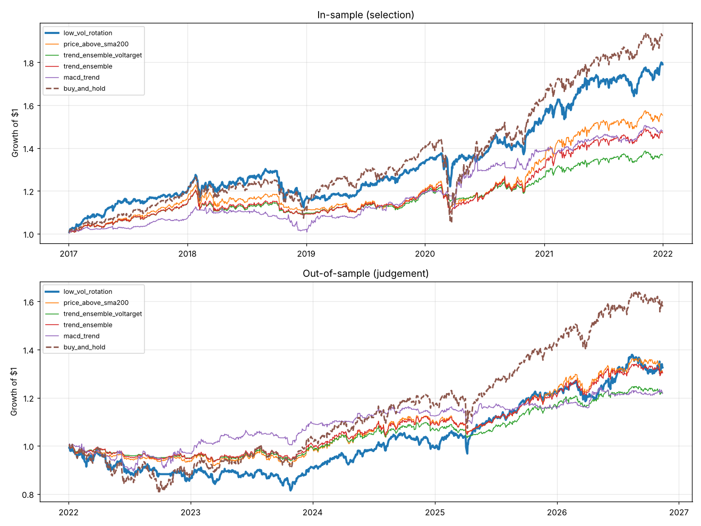

# Strategy research report

Universe: SPY, QQQ, IWM, EFA, EEM, TLT, IEF, GLD, XLE, XLK, XLF, XLV (daily, split/dividend adjusted, Alpaca SIP data).
Costs: 5.0 bps per unit of turnover. Signals use the close of day t and trade for day t+1.
In-sample: 2017-01-01 to 2021-12-31. Out-of-sample: 2022-01-01 to 2026-11-13.

Selection rule (fixed before looking at out-of-sample results): highest in-sample Sharpe
among strategies with an in-sample max drawdown no worse than buy & hold.

**Chosen strategy: `low_vol_rotation`**

## In-sample (ranked by Sharpe)

| strategy                 | CAGR   | Vol   |   Sharpe | MaxDD   |   Calmar |   TurnoverPerYr | PctDaysInvested   |
|:-------------------------|:-------|:------|---------:|:--------|---------:|----------------:|:------------------|
| low_vol_rotation         | 12.4%  | 9.8%  |     1.24 | -13.8%  |     0.9  |            5.7  | 100.0%            |
| price_above_sma200       | 9.2%   | 8.3%  |     1.1  | -10.6%  |     0.87 |            7.29 | 100.0%            |
| trend_ensemble_voltarget | 6.5%   | 6.0%  |     1.07 | -9.2%   |     0.71 |            5.94 | 100.0%            |
| trend_ensemble           | 8.0%   | 7.5%  |     1.07 | -11.0%  |     0.73 |            5.24 | 100.0%            |
| macd_trend               | 8.1%   | 7.6%  |     1.07 | -10.5%  |     0.78 |           19.87 | 98.3%             |
| ema_cross_12_26          | 7.8%   | 7.8%  |     1    | -12.1%  |     0.65 |            8.14 | 99.9%             |
| buy_and_hold             | 14.0%  | 14.5% |     0.98 | -27.2%  |     0.51 |            0    | 100.0%            |
| ts_momentum_12m          | 8.3%   | 9.0%  |     0.94 | -14.3%  |     0.58 |            5.37 | 99.9%             |
| donchian_55_20           | 5.5%   | 6.3%  |     0.89 | -8.2%   |     0.67 |            4.3  | 95.8%             |
| trend_plus_reversion     | 4.1%   | 5.0%  |     0.83 | -8.8%   |     0.47 |            9.5  | 100.0%            |
| sma_cross_50_200         | 8.8%   | 11.0% |     0.83 | -21.7%  |     0.41 |            1.22 | 100.0%            |
| momentum_rotation_top3   | 11.5%  | 16.9% |     0.73 | -27.3%  |     0.42 |            7.07 | 100.0%            |
| stochastic_reversion     | 3.4%   | 5.0%  |     0.69 | -7.1%   |     0.48 |            9.92 | 82.1%             |
| dual_momentum            | 11.1%  | 20.9% |     0.61 | -24.0%  |     0.46 |           10.21 | 97.9%             |
| adx_trend                | 2.6%   | 4.8%  |     0.55 | -8.2%   |     0.31 |           11.86 | 93.4%             |
| bollinger_reversion      | 2.4%   | 10.7% |     0.28 | -24.2%  |     0.1  |            8.49 | 73.6%             |
| rsi2_reversion           | 0.2%   | 3.7%  |     0.08 | -9.3%   |     0.03 |           14.24 | 56.2%             |

## Out-of-sample (same order)

| strategy                 | CAGR   | Vol   |   Sharpe | MaxDD   |   Calmar |   TurnoverPerYr | PctDaysInvested   |
|:-------------------------|:-------|:------|---------:|:--------|---------:|----------------:|:------------------|
| low_vol_rotation         | 6.0%   | 10.5% |     0.61 | -18.0%  |     0.33 |            6.91 | 98.3%             |
| price_above_sma200       | 5.6%   | 8.0%  |     0.72 | -8.6%   |     0.66 |            9.06 | 99.8%             |
| trend_ensemble_voltarget | 4.2%   | 5.9%  |     0.72 | -6.6%   |     0.64 |            6.71 | 100.0%            |
| trend_ensemble           | 5.6%   | 7.2%  |     0.79 | -6.9%   |     0.81 |            5.72 | 100.0%            |
| macd_trend               | 4.1%   | 7.3%  |     0.59 | -11.3%  |     0.37 |           20.16 | 96.1%             |
| ema_cross_12_26          | 5.6%   | 7.4%  |     0.78 | -7.5%   |     0.75 |            8.21 | 98.1%             |
| buy_and_hold             | 9.9%   | 13.2% |     0.78 | -19.5%  |     0.51 |            0    | 100.0%            |
| ts_momentum_12m          | 6.7%   | 9.0%  |     0.76 | -10.8%  |     0.62 |            5.83 | 99.9%             |
| donchian_55_20           | 3.1%   | 5.6%  |     0.58 | -7.1%   |     0.44 |            4.54 | 93.8%             |
| trend_plus_reversion     | 4.1%   | 4.5%  |     0.92 | -4.2%   |     0.98 |            9.96 | 100.0%            |
| sma_cross_50_200         | 6.7%   | 9.0%  |     0.76 | -10.6%  |     0.63 |            1.43 | 99.9%             |
| momentum_rotation_top3   | 6.1%   | 15.6% |     0.45 | -16.8%  |     0.36 |            6.74 | 98.3%             |
| stochastic_reversion     | 1.9%   | 4.4%  |     0.45 | -8.1%   |     0.24 |            9.71 | 81.1%             |
| dual_momentum            | 28.4%  | 26.5% |     1.08 | -26.0%  |     1.09 |            4.95 | 99.4%             |
| adx_trend                | 1.4%   | 4.5%  |     0.33 | -7.8%   |     0.18 |           12.36 | 92.1%             |
| bollinger_reversion      | 4.4%   | 7.1%  |     0.64 | -5.3%   |     0.82 |            8.88 | 71.5%             |
| rsi2_reversion           | 2.6%   | 2.8%  |     0.93 | -2.1%   |     1.21 |           14.8  | 55.5%             |

